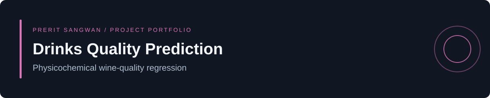

[](https://github.com/Preritsangwan17/Drinks-Quality-Prediction-System-/actions/workflows/ci.yml)

# Drinks Quality Prediction

A command-line machine-learning baseline for **regression**, with reproducible training, held-out evaluation,
model serialization and batch prediction. It includes an official UCI dataset downloader with checksum
verification, real-data evaluation records and software tests.

**Status:** reproducible research baseline, evaluated separately on UCI red and white wine data.


[Quick start](#quick-start) · [Results](#reproduced-uci-evaluation) · [Dataset](data/README.md) · [Model card](docs/MODEL_CARD.md) · [Contributing](CONTRIBUTING.md)

## What it does

The pipeline compares a median DummyRegressor with a Random Forest regressor, selects by lowest
validation MAE, then reports test MAE, RMSE and R². Quality is treated as numeric regression: predictions
are continuous scores. Comma and semicolon CSVs are accepted; all feature columns must be numeric.
Missing numeric measurements are median-imputed using training data only. Required feature columns
must be present during prediction.

Both experiments use seed 42 and 60% training / 20% validation / 20% test partitions after deduplication.
The selected model remains fitted on the training partition. Test rows are reserved for the final
benchmark and do not influence model selection. Training writes an artifact and an adjacent `.metrics.json` report.

## Quick start

Use Python 3.11 or 3.12:

```bash
git clone https://github.com/Preritsangwan17/Drinks-Quality-Prediction-System-.git
cd Drinks-Quality-Prediction-System-
python3 -m venv .venv
source .venv/bin/activate
python -m pip install -r requirements.txt
python app.py --help
```

Download the official UCI data, then train and score the included example:

```bash
python scripts/download_data.py
python app.py train --data data/winequality-red.csv --output artifacts/red_wine.joblib
python app.py predict --input examples/wine_transactions.csv --model artifacts/red_wine.joblib --output artifacts/predictions.csv
```

The prediction CSV must contain the training feature columns; its target is optional.
Generated models, metrics and predictions live in `artifacts/` and are ignored by Git.
Only load serialized models from trusted sources.

## Reproduced UCI evaluation

Seed 42, scikit-learn 1.6.1, NumPy 1.26.4 and pandas 2.3.3. Both datasets use the same predefined
60/20/20 workflow, with model selection on validation MAE only. The test baseline is the training-median
predictor evaluated on the same held-out test rows.

| Dataset | Selected model | Test MAE | Median baseline MAE | Test RMSE | Test R² |
|---|---|---:|---:|---:|---:|
| Red wine | Random Forest | 0.4652 | 0.7022 | 0.6238 | 0.4507 |
| White wine | Random Forest | 0.5696 | 0.6482 | 0.7362 | 0.3391 |

MAE and RMSE are in wine-quality score points; smaller is better. R² is dimensionless. Inspect
[red-wine results](reports/red_wine.metrics.json) and [white-wine results](reports/white_wine.metrics.json)
for fingerprints, row counts and runtime versions. These row-split benchmarks do not establish
performance on a new producer, vintage, wine type or future collection.

## Repository guide

| Path | Purpose |
|---|---|
| `mlops_project/pipeline/training_pipeline.py` | Validation, preprocessing, training, evaluation and prediction |
| `app.py` | CLI entry point |
| `data/README.md` | Dataset contract and provenance requirements |
| `tests/` | Synthetic artifact round-trip and invalid-input tests |
| `.github/workflows/ci.yml` | Automated software tests |

## Verification

```bash
python -m pip install -r requirements-dev.txt
python -m pytest -q
```

Tests use explicitly synthetic data to verify executable behavior, schema checks and serialization.
They do not establish real-world model accuracy. See [contribution guidance](CONTRIBUTING.md).

## Limitations and development priorities

Predicts the sensory-quality score of wine from numeric physicochemical measurements. It does not assess every drink, certify safety or replace laboratory testing.

Dataset provenance and exact fingerprints are recorded in [data/README.md](data/README.md).
Use a producer-grouped or time-based evaluation when those identifiers are available. Interval estimates
and independent external validation remain development priorities.

## License and author

Code is covered by the existing [MIT license](LICENSE). Dataset terms are separate.
Built by [Prerit Sangwan](https://github.com/Preritsangwan17), B.Tech CSE (AI/ML).

## Model documentation

See the [model card](docs/MODEL_CARD.md) for the intended use, input contract, evaluation method and limitations.
For the recorded numerical environment, install `requirements-repro.txt` in a fresh virtual environment.
